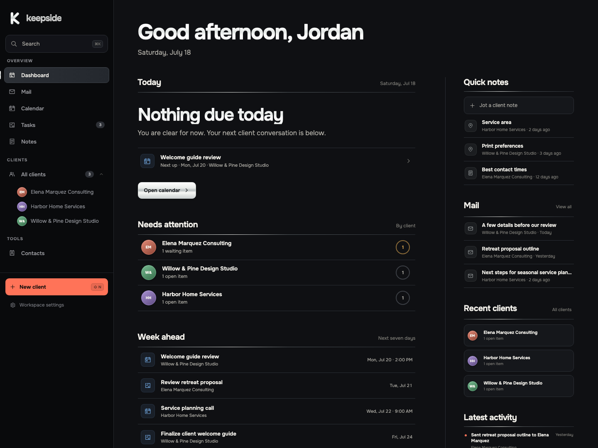
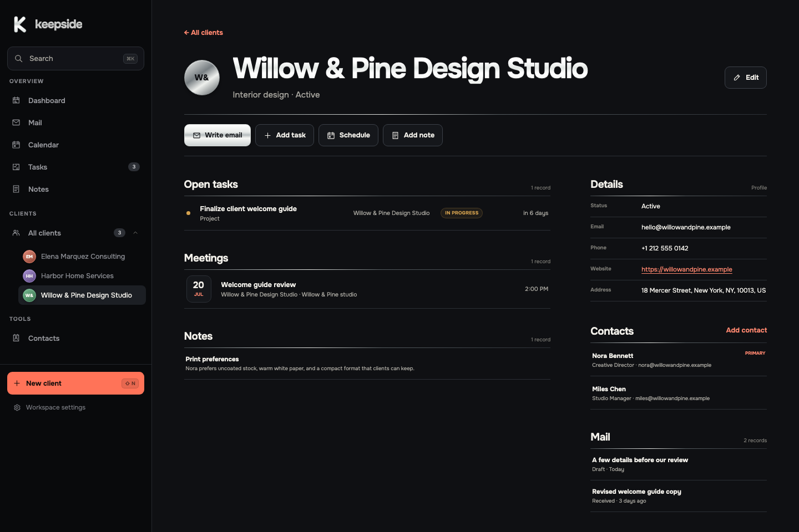
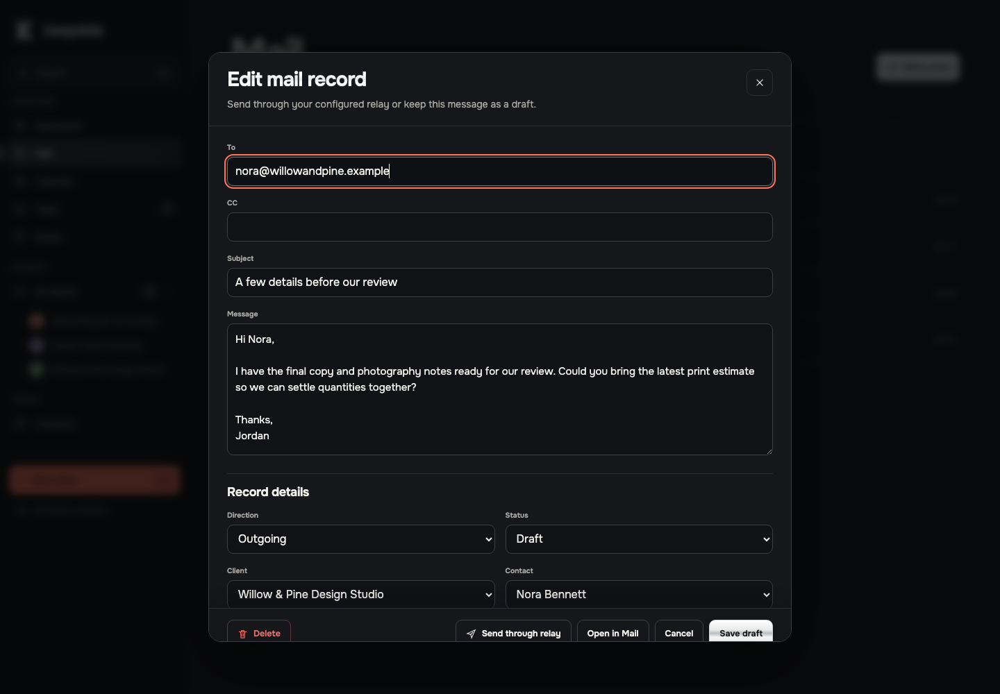

# Keepside

**Client work without the CRM ceremony.**

Keepside puts the people, promises, notes, meetings, and email around a client in one place. It is built for independent professionals and small practices that need a clear record of the relationship, not a sales machine.

This web edition is early software. Local mode is ready to use. The connected database and outbound mail boundary is available for server implementers and remains experimental.



## One client record, everything connected

A client record holds the work that is still open, conversations on the calendar, people involved, useful notes, and email history. Every edit goes back through the same validated workspace document.



## Email stays with the relationship

Keepside can open a draft in the computer's default mail app. A self-hosted build can also enable the outbound relay client. When **Send through relay** is used, Keepside marks the record Sent only after that relay returns an accepted receipt.



## What it keeps together

- clients and organizations
- primary and supporting contacts
- projects, tasks, services, and follow-ups
- meeting agendas and outcomes
- pinned notes and longer client context
- sent, received, and draft email records
- one portable JSON export of the complete workspace

There are no pipelines, lead scores, automation builders, AI summaries, or decorative performance widgets.

## Two clear modes

| | Local mode | Connected-mode framework |
| --- | --- | --- |
| Status | Default and usable now | Experimental integration boundary |
| Storage | One validated document in browser storage | The same document in your PostgreSQL service |
| Account | None | Supplied by your server |
| Email | Opens the default mail app | Optional authenticated outbound relay |
| Secrets | None | Server only, never in a `VITE_` variable |
| Conflicts | One browser profile | Conditional saves with `ETag` and `If-Match` |

Local mode makes no workspace or mail network request. Browser storage can still be cleared, so export a backup if the records matter.

Connected mode is not a hosted Keepside service. This repository supplies tested browser clients, an [OpenAPI contract](docs/openapi.yaml), a compact [PostgreSQL schema](docs/postgres.sql), and the [self-hosting security boundary](docs/SELF_HOSTING.md). You provide the authenticated server and mail-provider account.

## Run it locally

Requires Node.js 20.19 or newer.

```bash
git clone https://github.com/SebastianSteele/keepside-web.git
cd keepside-web
npm install
npm run dev
```

Open `http://localhost:5173`, then choose **Use sample workspace** or add a first client.

## Configure a connected API

The only browser setting is a public URL:

```bash
cp .env.example .env.local
```

```dotenv
VITE_KEEPSIDE_API_URL=/api
```

That enables the outbound relay action in the email editor. `WorkspaceApiClient` is the storage seam for a server-backed build, but Keepside does not switch a local workspace to remote storage automatically. A real product must ask whether to upload the local workspace or open the server copy, then use one store only.

Read [Connected mode reference](docs/SELF_HOSTING.md) before implementing the server. It covers owner isolation, revision conflicts, session cookies, origin checks, mail idempotency, rate limits, provider failures, and backups.

## Project shape

- `src/domain/types.ts` owns the record model.
- `src/domain/workspace.ts` owns validation and every persistence rule.
- `src/domain/sample.ts` owns the reproducible demonstration workspace.
- `src/infrastructure/serverClients.ts` owns the optional server transport.
- `src/screens` renders data and returns complete records. It does not persist them.

The app uses React, TypeScript, Vite, and browser APIs. It has no router, state library, component kit, icon dependency, date package, or styling framework.

See [Architecture](ARCHITECTURE.md) for the full ownership boundary.

## Verify a change

```bash
npm run typecheck
npm test
npm run build
npm audit --audit-level=high
```

The current screenshot build was checked in Chrome 150 on macOS at a 1440-pixel desktop width. Responsive layouts are included; reproducible browser reports are welcome.

## Data care

Keepside is not an encrypted records vault. Do not put regulated or highly sensitive material in browser storage without the device protection, retention policy, and backup process your work requires. Never attach a real workspace export to a public issue.

Security reports have a [private reporting route](https://github.com/SebastianSteele/keepside-web/security/advisories/new). General contributions are covered in [Contributing](CONTRIBUTING.md) and the [Code of conduct](CODE_OF_CONDUCT.md).

## Editions and license

This is the cross-platform React edition. The separate [native macOS edition](https://github.com/SebastianSteele/keepside) remains its own project.

Keepside is released under the [MIT License](LICENSE). The bundled Onest typeface uses the SIL Open Font License; details are in the [font credits](public/fonts/README.md).
